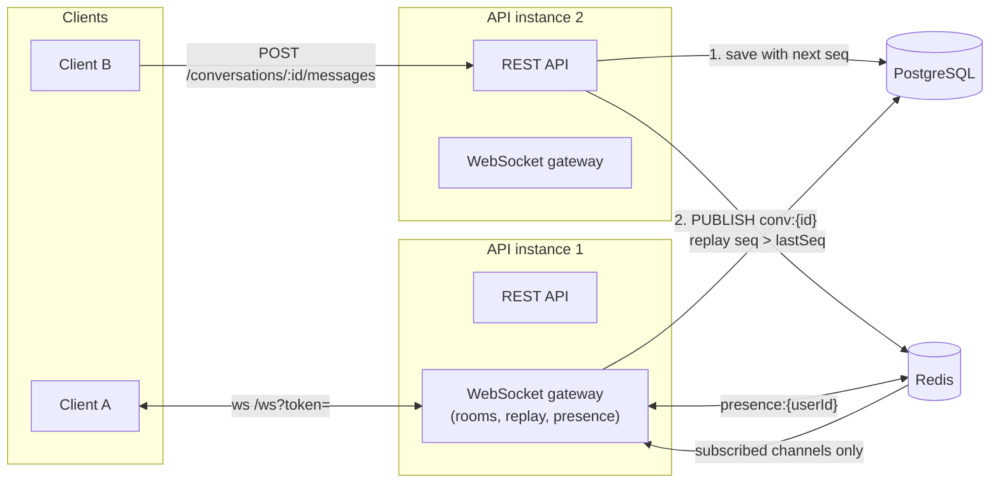
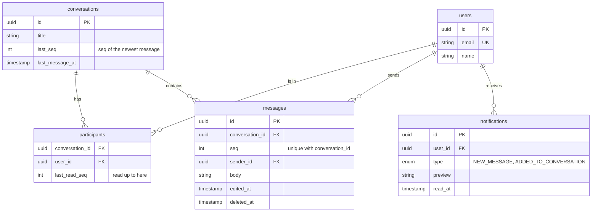

# realtime-notifications

A chat and notifications backend. Users create conversations, send messages over REST, and receive them live over WebSockets. Three mechanisms do the interesting work:

1. **Redis pub/sub**, so any number of API instances can share the live traffic.
2. **Presence in Redis** that cleans up after crashed instances.
3. **Per-conversation sequence numbers**, so a client that reconnects receives exactly the messages it missed, with no gaps and no duplicates.

**What runs where:** everything runs locally with Docker (Postgres, Redis and the API). No cloud account is needed. The project is **not deployed**.

**Stack:** Node 24, TypeScript (strict), Express 5, `ws`, Prisma 7, PostgreSQL 16, Redis 7 (ioredis), Zod, Jest + Supertest, ESLint + Prettier.

## Architecture



A message sent to any instance is saved first, then published to Redis. Every instance that has a socket in that conversation receives it and forwards it.

Each feature module has the same shape: `routes → controller → service → repository` plus its own Zod `schemas`. Services never touch Express, sockets or Prisma. They publish events through an `EventPublisher` interface.

```
src/
  common/       config, logger, errors + handler, validate, pagination, auth middleware,
                Prisma singleton, Redis connections (commands + subscriber), base repository
  modules/      users, conversations, messages, notifications
  realtime/     gateway.ts (upgrade + auth), client-connection.ts (one socket),
                conversation-subscription.ts (replay hand-over), rooms.ts (pub/sub),
                presence.ts, publisher.ts, protocol.ts (message schemas + event types)
  container.ts  composition root
  server.ts     one HTTP server for REST and WebSockets
scripts/        start-with-secrets.ts (container entrypoint), load-test.ts
tests/          unit/ and integration/ (real Postgres + Redis, real sockets, two instances)
```

## Data model



## Run it

Requires Docker.

```bash
cp .env.example .env
docker compose up --build
```

The API and WebSocket gateway listen on <http://localhost:3000>. Host ports default to **5442** (Postgres) and **6381** (Redis); override them with `POSTGRES_HOST_PORT`, `REDIS_HOST_PORT` and `API_HOST_PORT`.

Try it with two terminals:

```bash
# Register two users
A=$(curl -s localhost:3000/auth/register -H 'Content-Type: application/json' \
  -d '{"email":"a@example.com","name":"A","password":"password-123"}' | jq -r .data.token)
B_JSON=$(curl -s localhost:3000/auth/register -H 'Content-Type: application/json' \
  -d '{"email":"b@example.com","name":"B","password":"password-123"}')
B=$(echo "$B_JSON" | jq -r .data.token); B_ID=$(echo "$B_JSON" | jq -r .data.user.id)

# A starts a conversation with B
CONV=$(curl -s localhost:3000/conversations -H "Authorization: Bearer $A" -H 'Content-Type: application/json' \
  -d "{\"participantIds\":[\"$B_ID\"]}" | jq -r .data.id)

# Terminal 2: B connects (any WebSocket client, e.g. `npx wscat`) and subscribes
npx wscat -c "ws://localhost:3000/ws?token=$B"
> {"type":"subscribe","conversationId":"<CONV>","lastSeq":0}

# Terminal 1: A sends; B's socket receives message.created and notification.created
curl -s localhost:3000/conversations/$CONV/messages -H "Authorization: Bearer $A" \
  -H 'Content-Type: application/json' -d '{"body":"hello"}'
```

### Tests and lint

```bash
docker compose up -d postgres redis   # tests use the realtime_test database and Redis db 1
npm ci
npm run lint
npm test                              # unit + integration
```

`npm run dev` runs the API with live reload from your shell, reading `.env`.

## Endpoints

Every REST response uses one envelope: `{ "data": … }`, plus `"meta": { page, pageSize, total, totalPages }` on lists. Errors are `{ "error": { "code", "message", "details"? } }`. Every list takes `?page=&pageSize=`. Bodies, query strings, path params and WebSocket messages are all validated with Zod. Only participants can see a conversation; everyone else gets 404.

| Method               | Path                                                         | Notes                                             |
| -------------------- | ------------------------------------------------------------ | ------------------------------------------------- |
| GET                  | `/health`                                                    |                                                   |
| POST                 | `/auth/register` · `/auth/login`                             | Return a JWT                                      |
| GET · PATCH · DELETE | `/users/me`                                                  |                                                   |
| GET                  | `/users` (`?search=`) · `/users/:id` · `/users/:id/presence` |                                                   |
| POST · GET           | `/conversations`                                             | List is newest activity first, with `unreadCount` |
| GET · PATCH          | `/conversations/:id`                                         |                                                   |
| POST                 | `/conversations/:id/participants`                            | Add someone                                       |
| DELETE               | `/conversations/:id/participants/me`                         | Leave; the last to leave deletes it               |
| POST                 | `/conversations/:id/read`                                    | `{ seq }`: read position only moves forward       |
| GET                  | `/conversations/:id/presence`                                | Who is online                                     |
| POST · GET           | `/conversations/:id/messages`                                | GET supports `?afterSeq=`                         |
| PATCH · DELETE       | `/messages/:id`                                              | Sender only; delete is soft                       |
| GET                  | `/notifications` (`?unread=true`)                            |                                                   |
| POST                 | `/notifications/:id/read` · `/notifications/read-all`        |                                                   |
| DELETE               | `/notifications/:id`                                         |                                                   |

### WebSocket protocol: `ws://host/ws?token=<JWT>`

| Client → server                                        |                                                     |
| ------------------------------------------------------ | --------------------------------------------------- |
| `{ "type": "subscribe", "conversationId", "lastSeq" }` | Replays messages after `lastSeq`, then streams live |
| `{ "type": "unsubscribe", "conversationId" }`          |                                                     |
| `{ "type": "ping" }`                                   | Answered with `pong`                                |

| Server → client                                           |                                                                                      |
| --------------------------------------------------------- | ------------------------------------------------------------------------------------ |
| `message.created` / `message.updated` / `message.deleted` | `{ message: { id, conversationId, seq, senderId, body, … } }`                        |
| `notification.created`                                    | Sent to the user on every connected socket                                           |
| `replay.done`                                             | `{ conversationId, lastSeq }`: the replay is complete and the socket is now live     |
| `replay.truncated`                                        | More than `REPLAY_LIMIT` were missed: page through `GET …/messages?afterSeq=fromSeq` |
| `error` · `pong`                                          |                                                                                      |

## Key design decisions

**Gap-free sequence numbers from a row lock** (`MessageRepository.append`). Sending a message runs one transaction:

1. `UPDATE conversations SET last_seq = last_seq + 1 … RETURNING last_seq`
2. Insert the message with that number.

Step 1 locks the conversation row until commit, so concurrent senders in one conversation take turns. Different conversations never block each other. If the insert fails, the increment rolls back with it, so there are no holes. A test fires 50 concurrent sends and checks the numbers are exactly 1–50. Unread counts fall out for free: `last_seq − last_read_seq`.

**Redis pub/sub with per-instance subscriptions** (`realtime/rooms.ts`). Services publish to `conv:{id}` (or `user:{id}` for notifications) after the database commit. Each instance subscribes to a channel only while one of its own sockets needs it: it subscribes on the first join and unsubscribes on the last leave. `join` waits for Redis to confirm the subscription, which the replay logic depends on. A test starts two instances, each with its own Redis connections, and checks that a message sent through instance B reaches a socket on instance A.

**Reconnect without gaps or duplicates** (`realtime/conversation-subscription.ts`). The order matters:

1. Join the room. Live events start arriving and are held in a buffer.
2. Load `seq > lastSeq` from Postgres and send it.
3. Send the buffered events, skipping any `seq` already sent.
4. Go live.

Joining first means anything published during the query is caught by the buffer. The seq check means anything both replayed and buffered is sent once. Unit tests cover each ordering case directly. An integration test subscribes while 20 messages are being sent concurrently and checks the client receives exactly 1–40, in order.

**Presence that survives crashes** (`realtime/presence.ts`). `presence:{userId}` is a sorted set with one member per connection, scored by its expiry time. Each socket refreshes its entry on a heartbeat (25 s by default; entries live 60 s). A user is online while any entry is unexpired. A crashed instance's sockets never clean up, but their entries just expire. A plain connection counter would leave those users online forever. A test checks the expiry using explicit timestamps.

**Authentication at the upgrade.** The JWT is checked before the WebSocket handshake completes, so a bad token gets a plain HTTP 401 and never gets an open socket. The token goes in the query string because browsers can't set headers on a WebSocket. Dead connections are found with ping/pong and terminated.

**Save first, publish second.** If publishing to Redis fails, the error is logged and the request still succeeds. The message is safely stored, and clients receive it on their next reconnect replay.

**Patterns, only where they earn their place.**

- _Singleton:_ the Prisma client, the two Redis connections (a subscribe-mode connection can't run other commands) and config.
- _Repository:_ all data access, with a generic `BaseRepository` for CRUD.
- No Factory or Strategy: nothing here has interchangeable implementations or behaviour that varies by type.

## Results

Not yet measured, run `npm run loadtest`.

(`scripts/load-test.ts` connects `CLIENTS` sockets to one conversation, sends `MESSAGES` messages over REST and prints delivered/expected and p50/p95/p99/max latency from send to receipt.)

## Known limitations

- **Presence changes aren't pushed.** Online/offline is available over REST but not sent as a live event.
- **Leaving doesn't end a live subscription.** A socket already subscribed to a conversation keeps receiving its events after the user leaves, until it unsubscribes or reconnects.
- **Edits and deletions aren't replayed.** Reconnect replay resends new messages only. Edits and deletions made while a client was offline show up when it reloads messages over REST.
- **Notifications aren't batched.** Every message creates one row per other participant, so busy group chats generate a lot of rows.
- **Message sends in one conversation are serialised.** The row lock that guarantees ordering means a single very busy conversation is limited by how fast those transactions commit.
- **The JWT can leak through logs.** The token is in the WebSocket URL, so proxies that log URLs will log it. Tokens are short-lived (1 h by default), and there are no refresh tokens.
- **One Redis subscription per connected user.** Each instance subscribes to the notification channel of every user connected to it, so an instance with many connected users holds many Redis subscriptions.

## Deployment

| File                              | Purpose                                                                                                                                                                                                                                                                                          |
| --------------------------------- | ------------------------------------------------------------------------------------------------------------------------------------------------------------------------------------------------------------------------------------------------------------------------------------------------ |
| `Dockerfile`                      | Multi-stage build: compiles TypeScript, then ships production dependencies and `dist/` only. Runs as the non-root `node` user, with a healthcheck on `/health`.                                                                                                                                  |
| `scripts/start-with-secrets.ts`   | Container entrypoint. With `SECRETS_SOURCE=aws` it loads one JSON secret (`SECRET_ID`) from AWS Secrets Manager into the environment; with `local` it uses `.env`. It fails fast if the secret or a required key (`DATABASE_URL`, `REDIS_URL`, `JWT_SECRET`) is missing, then starts the server. |
| `deploy/ecs-task-definition.json` | ECS Fargate task definition template with `${…}` placeholders for account id, region, image tag, role ARNs and secret id.                                                                                                                                                                        |
| `.github/workflows/deploy.yml`    | Manual-only (`workflow_dispatch`) workflow. It assumes an AWS role through GitHub OIDC (no stored keys), builds and pushes the image to ECR, fills in the task definition and updates the ECS service.                                                                                           |
| `.github/workflows/ci.yml`        | Runs lint, typecheck and the full test suite against Postgres and Redis service containers on every push and pull request.                                                                                                                                                                       |

Deployment config is provided as a reference. This project has not been deployed.
